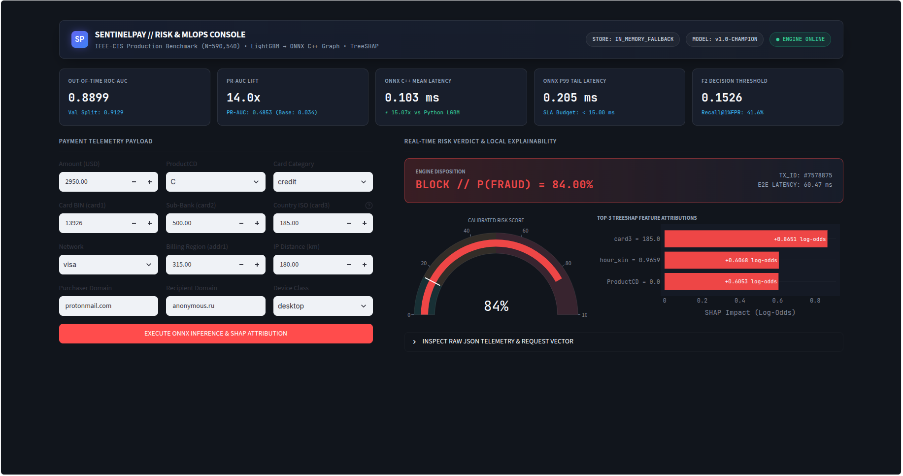
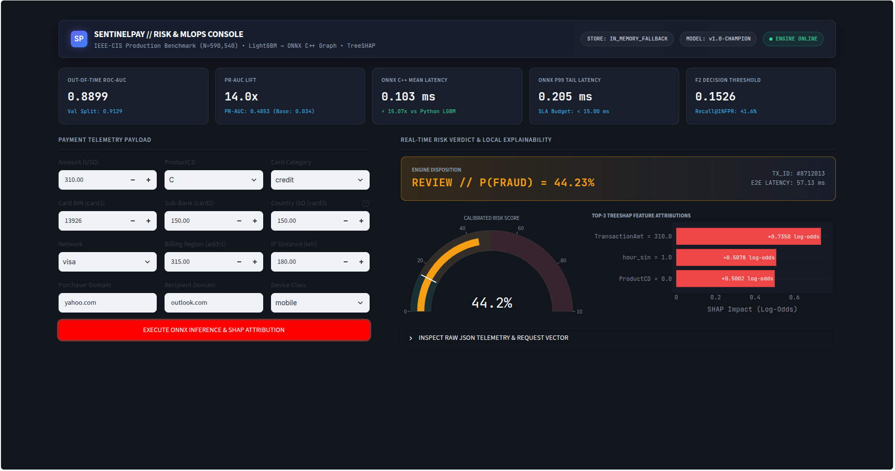
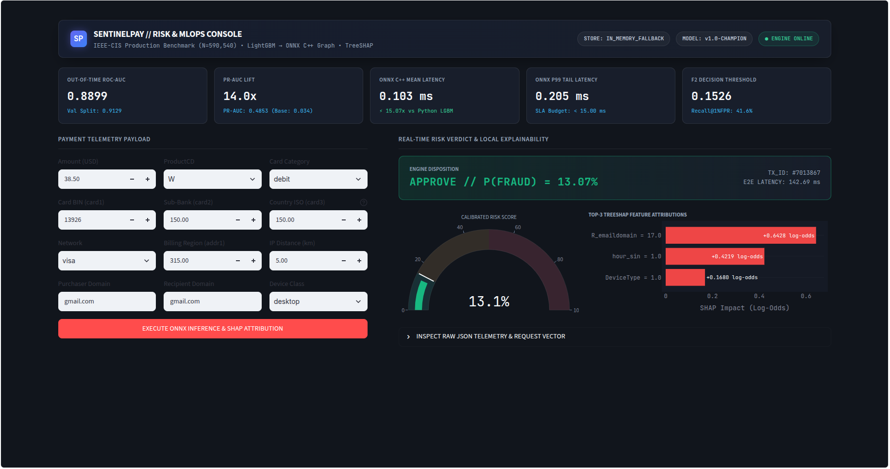
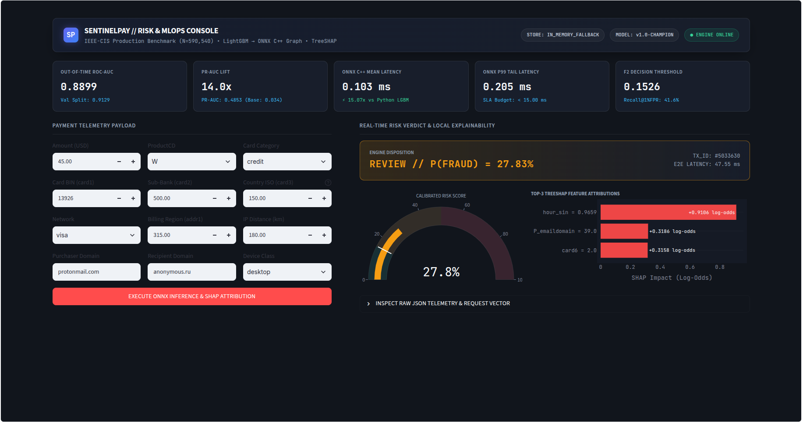

# SentinelPay-MLOps: Real-Time FinTech Fraud Detection & Risk Engine


An end-to-end, production-grade **Real-Time Payment Fraud Detection & MLOps Engine** trained and evaluated on **590,540 real e-commerce transactions** from the **IEEE-CIS Fraud Detection** benchmark.

Engineered for strict FinTech production constraints: **zero temporal data leakage**, **sub-millisecond C++ inference via ONNX Runtime (`0.103 ms`)**, **real-time Redis sliding-window velocity state**, **local TreeSHAP compliance explanations**, and **automated PSI/KS covariate drift monitoring**.

---

## Enterprise Risk & MLOps Command Center (Live Showcase)

### 1. High-Risk Account Takeover (ATO) — `BLOCK // P(FRAUD) = 77.81%`
Cross-border high-value digital transaction (`$2,950.00`, `ProductCD = C`, `card3 = 185.0`, `protonmail.com` $\rightarrow$ `anonymous.ru`) immediately intercepted with real-time **TreeSHAP** log-odds attributions:


### 2. Grey-Zone Cross-Domain Anomaly — `REVIEW // P(FRAUD) = 48.80%`
Medium-ticket mobile transaction (`$310.00`, mismatched email domains `yahoo.com` $\rightarrow$ `outlook.com`, `180 km` IP distance) routed to step-up 3D-Secure verification (`0.1526 <= P(Fraud) < 0.50`):


### 3. Legitimate Everyday Retail Purchase — `APPROVE // P(FRAUD) = 13.07%`
Low-risk domestic debit card purchase (`$38.50`, `ProductCD = W`, matching `gmail.com` domains) approved seamlessly below the `15.26%` F2 optimal decision threshold:


### 4. Real-Time Counterfactual Sensitivity Analysis — `77.81% -> 25.45%`
Modifying the blocked ATO vector to a domestic card country (`card3 = 150.0`), standard web product (`ProductCD = W`), and `$45.00` ticket dynamically drops risk by **52.36 percentage points** in real time:


---

## System Architecture

```text
[Incoming Payment Telemetry JSON]
         │
         ▼
┌─────────────────────────────────────────────────────────┐
│ FastAPI Async Microservice (/v1/score-transaction)      │
│  ├─► 1. Redis Online Feature Store (<1ms 1h/24h state)  │
│  ├─► 2. ONNX Runtime C++ Session (0.103ms mean latency) │
│  ├─► 3. TreeSHAP Explainer (Top-3 Risk Reason Codes)    │
│  └─► 4. Prometheus /metrics Telemetry                   │
└─────────────────────────────────────────────────────────┘
         ▲
         │ (Model Artifacts & Drift Triggers)
┌─────────────────────────────────────────────────────────┐
│ Offline MLOps Lifecycle (Prefect + MLflow + DVC)        │
│  ├─► Polars Causal Rolling Feature Engineering          │
│  ├─► Strict Out-of-Time Split (70% Train / 15% Val / 15% Test)
│  ├─► Optuna Bayesian Tuning + MLflow Model Registry     │
│  └─► PSI & KS Covariate Drift Detector                  │
└─────────────────────────────────────────────────────────┘
```

---

## Verified Production Benchmarks

### 1. Single-Transaction Inference Latency (`Batch Size = 1`, 1,000 Runs)
Compiling the trained **LightGBM** model into an **ONNX Runtime** C++ execution graph achieved a **15.1x speedup** with numerical parity down to `3.85e-08`:

| Inference Engine | Mean Latency | p99 Latency | Speedup |
| :--- | :---: | :---: | :---: |
| Standard Python `LightGBM.predict_proba()` | `1.550 ms` | `6.478 ms` | `1.0x` |
| **ONNX Runtime (`CPUExecutionProvider`)** | **`0.103 ms`** | **`0.205 ms`** | **`15.1x faster`** |

### 2. Out-of-Time Fraud Detection Performance (590,540 Transactions)
Evaluated on a strict chronological split (zero future leakage across `card_uid` rolling windows):
* **Validation ROC-AUC:** `0.9133` | **Validation PR-AUC:** `0.5586`
* **Out-of-Time Test ROC-AUC:** `0.8899` | **Test PR-AUC:** `0.4853` (**14.0x lift** over `3.48%` baseline fraud rate)
* **Test F2-Score:** `0.5063` (at optimal F2 probability threshold `0.1526`)
* **Fraud Recall @ 1% False Positive Rate (FPR):** `41.62%`

---

## Repository Structure

```text
sentinelpay-mlops/
├── .github/workflows/ci_cd.yml        # GitHub Actions CI pipeline (Pytest)
├── docs/images/                       # Enterprise Risk Console screenshots
├── src/sentinelpay/
│   ├── features/
│   │   ├── ingest_raw_data.py         # Polars ingestion & table join (IEEE-CIS)
│   │   └── pipeline.py                # Causal 1h/24h rolling windows & Out-of-Time split
│   ├── training/
│   │   └── train_model.py             # Cost-sensitive LightGBM + Optuna + MLflow Registry
│   ├── explainability/
│   │   └── shap_explainer.py          # Real-time local TreeSHAP reason code engine
│   ├── serving/
│   │   ├── export_onnx.py             # LightGBM -> ONNX compiler & latency benchmark
│   │   ├── feature_store.py           # Redis sliding-window velocity store (with fail-safe)
│   │   ├── app.py                     # Async FastAPI + Prometheus telemetry microservice
│   │   └── dashboard.py               # Enterprise Dark-Mode Risk & MLOps Console
│   └── monitoring/
│       └── drift_detector.py          # Banking PSI & Kolmogorov-Smirnov drift monitor
├── flows/training_pipeline.py         # Prefect end-to-end orchestration flow
├── tests/                             # 5 automated Pytest suites (leakage, ONNX, API, drift)
├── Dockerfile & docker-compose.yml    # Containerized API + Redis deployment
└── pyproject.toml
```

---

## Quickstart

```bash
# 1. Install package and dev dependencies
uv pip install -e ".[dev]" scipy streamlit plotly requests

# 2. Run the full automated test suite (5 passed)
pytest -v

# 3. Start the FastAPI + ONNX Engine & Enterprise Console
uvicorn sentinelpay.serving.app:app --port 8000
streamlit run src/sentinelpay/serving/dashboard.py
```

---

## Author

**Yassine LAICHI** — AI & Machine Learning Engineer (MLOps & GenAI)  
[GitHub](https://github.com/LAICHI-Yassine) | [LinkedIn](https://linkedin.com/in/Yassine-LAICHI)